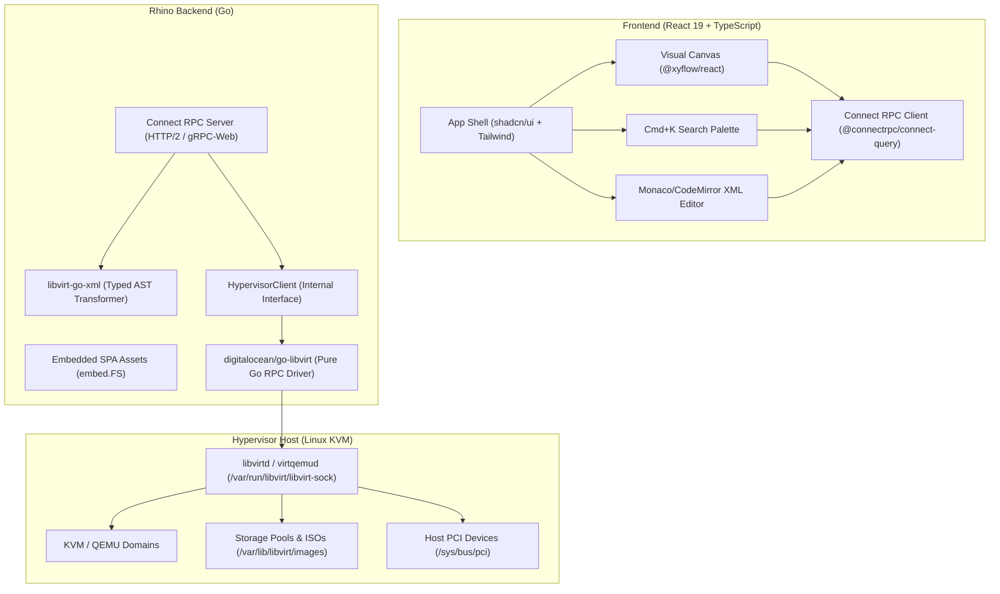

# Rhino: Visual Node-Based Hypervisor Architecture Blueprint

## 1. Executive Summary

Rhino is a modern, visual virtual machine management platform for libvirt / KVM. It replaces nested configuration tabs and manual XML editing with a **Visual Node-Based Canvas Layout** (inspired by Blender nodes and Unreal Engine Blueprints), backed by a single-binary Go backend serving Connect RPC to a React + React Flow frontend.

---

## 2. System Architecture & Decisions



### 2.1 Core Technology Stack
- **Backend**: Go (Golang) — Single standalone static binary embedding the frontend SPA via `//go:embed`.
- **API Protocol**: **Connect RPC** over HTTP/2 and gRPC-Web with Protobuf definitions managed by `buf`.
- **Libvirt Engine**: `digitalocean/go-libvirt` (pure Go RPC client over `/var/run/libvirt/libvirt-sock` or SSH/TCP, zero CGo dependencies) wrapped behind a modular `HypervisorClient` Go interface.
- **XML Layer**: Official `libvirt.org/go/libvirtxml` (`libvirt-go-xml`) for strongly typed domain/device struct manipulation.
- **Frontend**: React (Vite + TypeScript) + Tailwind CSS + shadcn/ui.
- **Node Engine**: `@xyflow/react` (React Flow) for canvas zooming, dragging, custom nodes, and diff-aware wire connections.
- **Console**: Deferred to post-MVP; MVP focuses on configuration, lifecycle, and telemetry.

---

## 3. Key Architectural Decisions (From Grill-Me Session)

| Decision Area | Selected Design | Rationale |
| :--- | :--- | :--- |
| **Canvas Scope** | **Hybrid Hierarchy** | Global macro canvas for virtual networks, storage pools, and VMs; drill-down into a dedicated hardware blueprint canvas per VM. |
| **Mutation Semantics** | **Draft & Commit with Hotplug Detection** | Wire additions/removals buffer locally as visual diffs (animated dotted for additions, red dashed for deletions). "Apply Changes" hotplugs compatible devices immediately and stages non-hotpluggable changes with a "Reboot Required" banner. |
| **Libvirt Driver** | **Pure Go RPC (`go-libvirt`) + Modular Interface** | Zero CGo dependency enables seamless macOS local development and lightweight static binary compilation, while keeping the door open for CGo if needed later. |
| **Search-to-Capability UX** | **Config First, Then Auto-Wire** | `Cmd+K` palette opens a focused modal with discovered host resources (e.g. list of GPUs or storage volumes). Submitting spawns the node pre-wired in a staged state. |
| **Host Resource Discovery** | **Full Discovery API** | Backend exposes queries for libvirt storage pools, virtual networks, and node PCI devices, powering searchable dropdown pickers in the UI. |
| **Creation Wizard** | **Immediate Define & Open Canvas** | Minimal inputs (Name, vCPUs, RAM, Boot ISO) instantly defines baseline VM in libvirt and navigates into its visual canvas. |
| **Escape Hatch** | **Bidirectional Synced Buffer** | Editing Raw XML parses into `libvirtxml.Domain` and re-renders the exact same visual boxes on the canvas, preserving coordinates. |
| **Telemetry Streaming** | **Dynamic View Subscription** | 2-second overview stream on global canvas; 1-second detailed stream (CPU%, RAM, disk I/O, net rate) for the active VM canvas. |
| **Security & Auth** | **Local / Trusted LAN + Optional Token** | Zero friction by default on localhost; optional `--token` or env var for bearer auth. |

---

## 4. Hardware Capability Taxonomy (Initial Scope)

The central **VM Core Node** connects directly to labeled capability nodes:

1. **Virtual Storage / Disk Node `[Storage]`**:
   - Source: QCOW2 / RAW volume from storage pool, or CD-ROM ISO boot media.
   - Target Bus: VirtIO (`vdX`), SATA (`sdX`), SCSI.
   - Attributes: Readonly, Boot Order, Cache mode.
2. **Network Interface Node `[Network]`**:
   - Source: Default NAT network or Host Linux Bridge (`br0`).
   - Model: VirtIO (`virtio`), e1000e.
   - Attributes: MAC address, IP address (reported via guest agent / arp).
3. **Compute Node `[Compute]`**:
   - Attributes: vCPU count, CPU topology (sockets, cores, threads), RAM allocation, memory ballooning.
4. **PCI Passthrough Node `[PCI Hostdev]`**:
   - Discovered Host PCI devices (GPUs, NICs) with vendor/device labels and IOMMU group validation.

---

## 5. Repository Layout

```
rhino/
├── buf.yaml                     # Protobuf configuration
├── buf.gen.yaml                 # Buf code generator (Go + TS)
├── proto/
│   └── rhino/
│       └── v1/
│           ├── vm.proto         # Domain lifecycle & telemetry streams
│           ├── hardware.proto   # Capability node mutations & types
│           └── host.proto       # Host storage/network/PCI discovery
├── server/
│   ├── cmd/
│   │   └── rhino/
│   │       └── main.go          # CLI entrypoint & embedded SPA server
│   ├── internal/
│   │   ├── hypervisor/          # Libvirt driver abstraction & go-libvirt client
│   │   │   ├── client.go        # HypervisorClient interface
│   │   │   ├── golibvirt.go     # digitalocean/go-libvirt implementation
│   │   │   └── mock.go          # Mock client for tests/dev without KVM
│   │   ├── service/             # Connect RPC service implementations
│   │   │   ├── vm_service.go
│   │   │   ├── hardware_service.go
│   │   │   └── host_service.go
│   │   └── xml/                 # libvirt-go-xml transformations & diff engine
├── web/
│   ├── package.json
│   ├── vite.config.ts
│   ├── src/
│   │   ├── components/
│   │   │   ├── canvas/          # React Flow custom nodes & edges
│   │   │   │   ├── VmCoreNode.tsx
│   │   │   │   ├── CapabilityNode.tsx
│   │   │   │   ├── DiffEdge.tsx
│   │   │   │   └── CanvasToolbar.tsx
│   │   │   ├── palette/         # Cmd+K search-to-capability dialogs
│   │   │   ├── wizard/          # Minimal VM creation wizard
│   │   │   └── editor/          # Monaco/CodeMirror raw XML editor
│   │   ├── gen/                 # Protobuf generated TypeScript clients
│   │   ├── hooks/               # Connect RPC streaming & query hooks
│   │   └── App.tsx
└── README.md
```

---

## 6. Phased Implementation Roadmap

### Phase 1: API & Backend Core Engine (First Priority)
- [ ] Initialize Go module (`go.mod`) and Buf configuration (`buf.yaml`, `buf.gen.yaml`).
- [ ] Define Protobuf schemas (`proto/rhino/v1/`):
  - `vm.proto`: Domain lifecycle (`ListDomains`, `GetDomain`, `StartDomain`, `StopDomain`, `DeleteDomain`, `StreamTelemetry`).
  - `host.proto`: Host discovery (`ListStoragePools`, `ListNetworks`, `ListNodeDevices`).
  - `hardware.proto`: Device mutation definitions (`AttachDevice`, `DetachDevice`, `UpdateDevice`).
- [ ] Implement `HypervisorClient` abstraction layer:
  - `client.go`: Unified interface decoupling business logic from libvirt drivers.
  - `golibvirt.go`: Production driver using `digitalocean/go-libvirt` over Unix socket / TCP / SSH.
  - `mock.go`: In-memory mock driver for local macOS development with realistic domain XMLs and simulated CPU/RAM telemetry.
- [ ] Implement XML AST transformation engine using `libvirt-go-xml`:
  - Typed domain parsing to extract Core, Disk, Network, and Hostdev definitions.
  - XML diff and mutation generators.
- [ ] Implement Connect RPC service handlers with unit and integration tests.
- [ ] Validate endpoints using `buf curl` / HTTP requests.

### Phase 2: Web Frontend & Visual Canvas
- [ ] Initialize React 19 + TypeScript + Vite + Tailwind CSS + shadcn/ui.
- [ ] Setup `@connectrpc/connect-query` and generated TypeScript Protobuf clients.
- [ ] Build the interactive canvas using `@xyflow/react`:
  - Central `VmCoreNode` displaying live gauges fed by `StreamTelemetry`.
  - Custom capability nodes (`[Storage]`, `[Network]`, `[Compute]`, `[PCI Hostdev]`).
  - Start/Stop lifecycle controls.

### Phase 3: Mutation Engine & Search-to-Capability
- [ ] Implement `Cmd+K` command palette connecting to Host Discovery RPCs.
- [ ] Implement Draft & Commit state with visual diff edges (animated dashed additions, red deletions).
- [ ] Implement backend hotplug/coldplug execution logic with `reboot_required` analysis.

### Phase 4: Creation Wizard & XML Escape Hatch
- [ ] Build Minimal Creation Wizard (Name, vCPUs, RAM, Boot ISO).
- [ ] Embed Monaco/CodeMirror editor with bidirectional buffer sync to the canvas.
- [ ] Package as a single binary using Go `//go:embed`.

### Phase 5: Advanced Topology & Console
- [ ] Global multi-VM topology canvas connecting VMs to Virtual Networks.
- [ ] In-browser console access (noVNC + xterm.js serial terminal).
