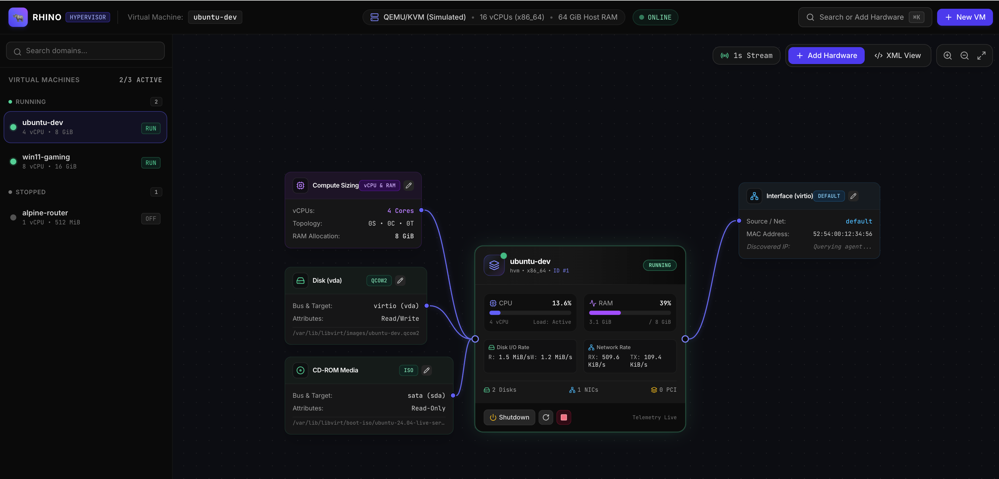
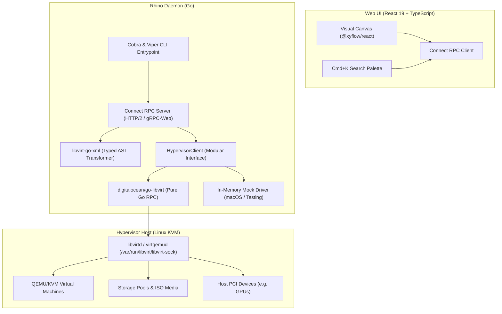

# rhino

> **Visual Node-Based Hypervisor Manager for libvirt & KVM**

[](https://golang.org)
[](https://buf.build)
[](https://connectrpc.com)
[](./LICENSE)

Rhino reimagines virtual machine management by replacing traditional nested configuration tabs with an **Interactive Node-Based Visual Canvas** (inspired by Blender nodes and Unreal Engine Blueprints), backed by a single-binary Go backend serving Connect RPC to a React Flow frontend.



---

## 📚 Documentation

| Document | Description |
| :--- | :--- |
| **[Architecture Blueprint](./ARCHITECTURE.md)** | Core system design, node taxonomy, and technology rationale |
| **[API Reference](./docs/API.md)** | Connect RPC services (`VMService`, `HostService`, `HardwareService`) and curl examples |
| **[CLI Reference](./docs/CLI.md)** | Command-line flags, Viper environment variables, and `rhino.yaml` syntax |
| **[Developer Guide](./docs/DEVELOPMENT.md)** | Local development workflow (macOS mock vs Linux KVM), building, and race testing |
| **[Engineering Plan](./plan/PLAN.md)** | Phased task breakdown and milestone progress |
| **[Project Memory](./PROJECT_MEMORY.md)** | Operational nuances, mock driver design, and deferred features backlog |

---

## Features

- 🎨 **Visual Node-Based Canvas Layout**: Machines exist as central core nodes with direct wired attachments to typed capability nodes (`[Storage]`, `[Network]`, `[Compute]`, `[PCI Hostdev]`).
- ⚡ **Zero-CGo Pure Go Architecture**: Powered by `digitalocean/go-libvirt` over Unix domain sockets or TCP, cross-compiling effortlessly into a standalone static binary without requiring host C development headers.
- 🔄 **Strongly-Typed XML AST Transformations**: Uses official `libvirt-go-xml` to inspect, serialize, and validate domain configurations without brittle string templating.
- 📊 **Real-Time Telemetry Streaming**: Native Server-Streaming RPCs push CPU utilization, active memory, disk throughput, and network rates directly to the client without custom WebSocket overhead.
- 🔌 **Dynamic Hotplug with Visual Diffs**: Wire modifications buffer locally as visual diffs (animated additions, red deletions) and intelligently hotplug supported devices (`virtio-blk`, `virtio-net`) or flag non-hotpluggable changes with a "Reboot Required" banner.
- 🔎 **Search-to-Capability (`Cmd+K`)**: Rapidly search hardware primitives with live host resource discovery (storage pools, ISO media, network bridges, and physical PCI GPUs).
- 🛠️ **Seamless macOS Local Development**: Built-in in-memory mock driver simulates live domains, storage pools, networks, and oscillating telemetry counters, allowing full UI and API development on macOS without requiring KVM.
- 📝 **Raw XML Escape Hatch**: Bidirectional synced editor validates and reflects changes directly onto the visual canvas.

---

## Architecture Overview



---

## Quick Start

### 1. Build the Binary

```bash
go build -o bin/rhino .
```

### 2. Start the Daemon

```bash
# On macOS: starts with the built-in mock hypervisor driver
./bin/rhino serve --addr :8080 --driver mock

# On Linux: connects to the local libvirt daemon socket
./bin/rhino serve --addr :8080 --driver libvirt --libvirt-sock /var/run/libvirt/libvirt-sock
```

### 3. Verify Endpoints

```bash
# Health check
curl http://localhost:8080/healthz

# List virtual machines
curl -s -X POST http://localhost:8080/rhino.v1.VMService/ListDomains \
  -H "Content-Type: application/json" \
  -d '{"includeInactive": true}'

# Get physical host hardware info
curl -s -X POST http://localhost:8080/rhino.v1.HostService/GetHostInfo \
  -H "Content-Type: application/json" -d '{}'
```

---

## CLI Configuration & Environment Variables

Rhino uses [Cobra](https://github.com/spf13/cobra) and [Viper](https://github.com/spf13/viper). All flags can be set via environment variables (`RHINO_*`) or a `rhino.yaml` configuration file:

```bash
# Using environment variables:
export RHINO_ADDR=":9000"
export RHINO_DRIVER="mock"
./bin/rhino serve
```

See [docs/CLI.md](file:///Users/miguel.santos/Projects/personal/rhino/docs/CLI.md) for the complete command reference.

---

## Testing

> [!IMPORTANT]
> **Always run tests with the `-race` flag** (`go test -v -race ./...`).

```bash
go test -v -race ./...
```

---

## Documentation Index

- 📐 **[ARCHITECTURE.md](./ARCHITECTURE.md)** — Core architecture, node taxonomy, and technology rationale.
- 📡 **[docs/API.md](./docs/API.md)** — Connect RPC service schemas, payloads, and curl invocation examples.
- 💻 **[docs/CLI.md](./docs/CLI.md)** — CLI flags, subcommands, and environment variable configuration.
- 🛠️ **[docs/DEVELOPMENT.md](./docs/DEVELOPMENT.md)** — Setup, local development on macOS, and Protobuf code generation.
- 📋 **[plan/PLAN.md](./plan/PLAN.md)** — Detailed implementation phases and progress tracking.
- 🧠 **[PROJECT_MEMORY.md](./PROJECT_MEMORY.md)** — Architectural rationale, mock driver requirements, and deferred backlog.
